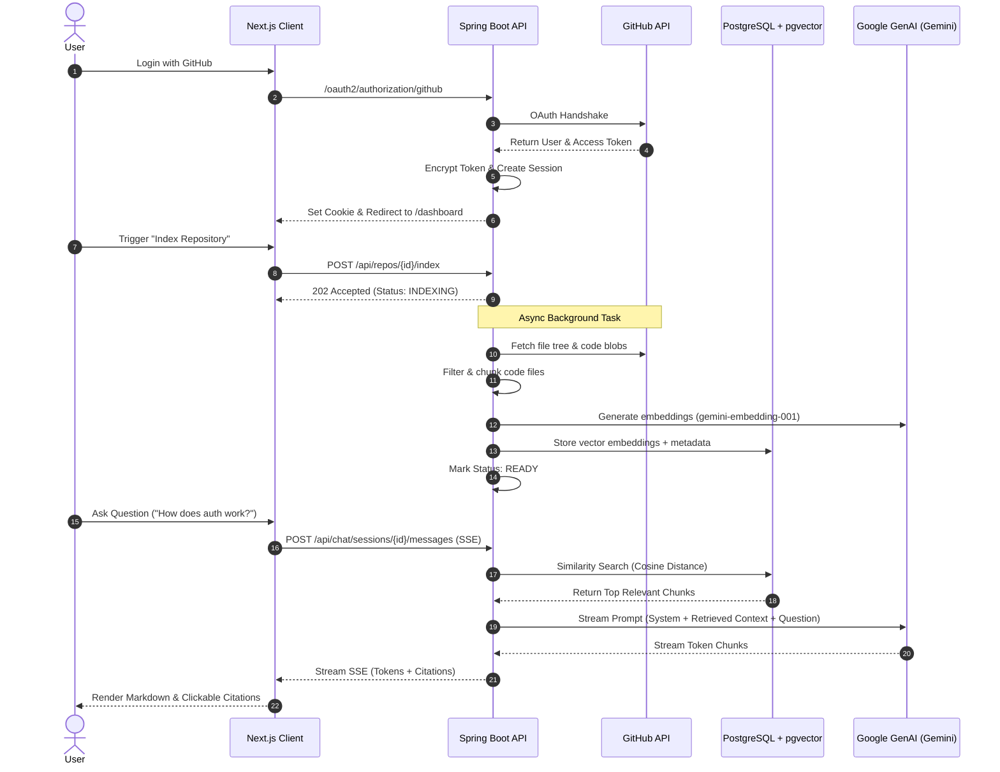

# RepoMind 🧠

> **AI-Powered Codebase Intelligence with Grounded Chat and Source Citations**

RepoMind is a full-stack, enterprise-grade developer tool that lets you connect your GitHub repositories, index entire codebases into a high-performance vector store, and chat with your code using Retrieval-Augmented Generation (RAG). Powered by **Spring Boot**, **Spring AI**, **Google Gemini**, and **Next.js**, RepoMind delivers grounded, hallucination-resistant answers with line-by-line source citations directly linking to GitHub.

---

## ✨ Features

- **🔐 GitHub OAuth Authentication**: Secure authentication with `read:user,repo` scopes, enabling access to both public and private repositories. GitHub access tokens are encrypted at rest using AES.
- **🔄 Repository Syncing**: Automatically synchronize your repositories, branches, primary languages, descriptions, and metadata directly from GitHub.
- **⚡ Asynchronous Code Indexing**:
  - Recursive tree traversal of repository contents via GitHub Git Trees API.
  - Intelligent file filtering (ignoring binary files, package lockfiles, `node_modules`, build artifacts like `target`, `.next`, `dist`, etc.).
  - Configurable file size limits (default 100 KB) and token-based code chunking (`TokenTextSplitter`).
  - GitHub secondary rate limit handling and retry backoff during vector generation.
- **📐 High-Performance Vector Search**: Code chunks and embeddings are stored in **PostgreSQL** with **pgvector** using **HNSW** indexing and cosine similarity.
- **💬 Retrieval-Augmented Chat (RAG)**:
  - Context retriever finds the top matching code chunks for any user prompt.
  - Strict system prompt constraints ensure answers rely exclusively on retrieved repository context.
- **🌊 Real-Time Streaming Responses (SSE)**: Fast, token-by-token streaming using Server-Sent Events (SSE).
- **📎 Precise Source Citations**: Every response includes clickable citation badges pointing to the exact file path and line numbers on GitHub.
- **🎨 Polished Next.js UI**:
  - Modern, responsive dashboard with light and dark mode (system default support).
  - Search and filter repositories by name, description, language, visibility (public/private), and index status.
  - Multi-session chat history per repository.
  - Rich markdown formatting with Shiki syntax highlighting for code blocks.

---

## 🏗️ Architecture & Workflow



---

## 🛠️ Tech Stack

### Backend
- **Framework**: [Spring Boot 4.1.1](https://spring.io/projects/spring-boot) (Java 21)
- **AI Framework**: [Spring AI 2.0.1](https://spring.io/projects/spring-ai)
  - Chat Model: `gemini-3.8-flash` (via `spring-ai-starter-model-google-genai`)
  - Embedding Model: `gemini-embedding-001` (768 dimensions)
  - Vector Store: `spring-ai-starter-vector-store-pgvector`
- **Security**: Spring Security 6 with OAuth2 Client & Spring Security Crypto (`TextEncryptor`)
- **Database**: PostgreSQL 16 with Spring Data JPA & Hibernate
- **REST & SSE**: Spring WebMVC (`RestClient`, `SseEmitter`)

### Frontend
- **Framework**: [Next.js 16](https://nextjs.org/) (App Router) + React 19 + TypeScript
- **Styling**: [Tailwind CSS v4](https://tailwindcss.com/), Radix UI / Base UI primitives, Lucide Icons
- **State & Data Fetching**: [@tanstack/react-query v5](https://tanstack.com/query)
- **Markdown & Code Highlighting**: `streamdown` with `@streamdown/code` (Shiki syntax highlighter)
- **Theming**: `next-themes` (Dark/Light mode)

### Infrastructure
- **Vector Database**: Dockerized PostgreSQL 16 with `pgvector`, `hstore`, and `uuid-ossp` extensions.

---

## 📂 Project Structure

```
RepoMind/
├── backend/                             # Spring Boot application
│   ├── pom.xml                          # Maven build configuration
│   └── src/
│       ├── main/java/RepoMind/backend/
│       │   ├── config/                  # SecurityConfig, CorsConfig, CryptoConfig, AppConfig
│       │   ├── controllers/             # AuthController, RepoController, ChatController
│       │   ├── dto/                     # Request and Response DTOs
│       │   ├── entity/                  # JPA Entities (User, Repository, ChatSession, ChatMessage)
│       │   ├── exceptions/              # GlobalExceptionHandler and custom exceptions
│       │   ├── repository/              # Spring Data JPA repositories
│       │   ├── security/                # GitHub OAuth2 user principal & service
│       │   └── services/
│       │       ├── ai/                  # RAG retriever, prompt builder, stream handler, citations
│       │       ├── github/              # GitHub REST API client & rate limiter
│       │       ├── indexing/            # File filter, token chunker, async indexing service
│       │       ├── ChatService.java     # Chat & session orchestration
│       │       ├── RepoService.java     # Repository sync and retrieval
│       │       └── UserService.java     # User management & token encryption
│       └── main/resources/
│           └── application.properties   # Spring Boot configurations & environment defaults
├── client/                              # Next.js frontend application
│   ├── app/
│   │   ├── auth/callback/               # OAuth redirect handler
│   │   ├── chat/[repoId]/               # Interactive code chat interface
│   │   ├── dashboard/                   # Repositories & overview dashboards
│   │   ├── login/                       # Sign-in page
│   │   └── page.tsx                     # Landing page
│   ├── components/
│   │   ├── chat/                        # ChatView, ChatComposer, ChatMessages, CitationChips
│   │   ├── dashboard/                   # RepoCard, StatCards, OverviewDashboard, Settings
│   │   ├── layout/                      # AppShell, BrandMark, Sidebar
│   │   └── ui/                          # Button, Card, Badge, Dialog, Skeleton, etc.
│   ├── hooks/                           # React Query hooks (useAuth, useRepos, useChat)
│   ├── lib/                             # API client, SSE stream reader, query keys
│   └── package.json                     # Frontend dependencies & scripts
├── docker/
│   └── postgres/
│       └── init-extensions.sql          # SQL script initializing pgvector & uuid-ossp
├── docker-compose.yml                   # PostgreSQL + pgvector container definition
└── README.md                            # Project documentation
```

---

## 🚀 Getting Started

### Prerequisites

Ensure you have installed:
- **Java 21** or later
- **Node.js 20+** and **npm** (or `pnpm` / `yarn`)
- **Docker** and **Docker Compose**
- A **GitHub OAuth Application** ([create one here](https://github.com/settings/applications/new))
  - Homepage URL: `http://localhost:3000`
  - Authorization callback URL: `http://localhost:8080/login/oauth2/code/github`
- A **Google Gemini API Key** ([obtain one here](https://aistudio.google.com/app/apikey))

---

### Step 1: Clone the Repository

```bash
git clone https://github.com/your-username/RepoMind.git
cd RepoMind
```

---

### Step 2: Start PostgreSQL with pgvector

Launch the database container using Docker Compose:

```bash
docker compose up -d
```

> **Note**: The container runs PostgreSQL 16 with `pgvector` exposed on port `5433` to prevent conflicts with any locally running PostgreSQL instance on port `5432`.

To verify database health:
```bash
docker compose ps
```

---

### Step 3: Configure Environment Variables

#### Backend Configuration
You can configure the backend via environment variables or edit `backend/src/main/resources/application.properties`:

| Variable | Description | Default |
|---|---|---|
| `DB_URL` | PostgreSQL JDBC connection URL | `jdbc:postgresql://localhost:5433/RepoMind` |
| `DB_USERNAME` | Database username | `postgres` |
| `DB_PASSWORD` | Database password | `postgres` |
| `GEMINI_API_KEY` | Google AI Studio API Key for Gemini | *(Required)* |
| `GITHUB_CLIENT_ID` | GitHub OAuth App Client ID | *(Required)* |
| `GITHUB_CLIENT_SECRET` | GitHub OAuth App Client Secret | *(Required)* |
| `FRONTEND_URL` | Frontend URL for OAuth redirect | `http://localhost:3000` |
| `CORS_ALLOWED_ORIGINS` | Permitted CORS origins | `http://localhost:3000` |
| `TOKEN_ENCRYPTOR_PASSWORD` | Symmetric encryption key for stored tokens | `repomind-local-encrypt-key` |
| `TOKEN_ENCRYPTOR_SALT` | Hex salt for token encryption | `5c0744940b5c369b` |

Export the required environment variables in your terminal:

```bash
export GEMINI_API_KEY="your-gemini-api-key"
export GITHUB_CLIENT_ID="your-github-client-id"
export GITHUB_CLIENT_SECRET="your-github-client-secret"
```

#### Frontend Configuration
Inside `client/`, create a `.env.local` file (optional, defaults to `http://localhost:8080`):

```bash
NEXT_PUBLIC_API_BASE_URL=http://localhost:8080
```

---

### Step 4: Run the Backend

Navigate to the `backend` directory and start the application using the Maven wrapper:

```bash
cd backend
./mvnw spring-boot:run
```

The Spring Boot backend will start on **`http://localhost:8080`**. On startup, Hibernate automatically updates schema tables and registers the `vector` table definitions.

---

### Step 5: Run the Frontend

Open a new terminal window, navigate to the `client` directory, install dependencies, and start the development server:

```bash
cd client
npm install
npm run dev
```

The Next.js frontend will be running on **`http://localhost:3000`**.

---

## 📖 Usage Guide

1. **Sign In**: Navigate to `http://localhost:3000` and click **"Continue with GitHub"**. Authorize the application on GitHub.
2. **Sync Repositories**: Once redirected to the `/dashboard`, RepoMind fetches your GitHub repositories. Click **"Sync"** anytime to refresh the list.
3. **Index a Repository**:
   - Locate any repository card on the dashboard.
   - Click **"Index repository"**.
   - Watch the real-time progress bar as RepoMind downloads source files, splits them into token chunks, generates vector embeddings, and stores them in pgvector.
4. **Chat with Code**:
   - Once the status transitions to **Ready**, click **"Chat"**.
   - Ask technical questions about the project (e.g., *"How is user authentication implemented?"*, *"Explain the vector store configuration"*).
   - Read the streaming answer and click any citation chip to jump straight to the source lines on GitHub!

---

## 📡 REST & SSE API Reference

### Authentication
| Method | Endpoint | Description |
|---|---|---|
| `GET` | `/oauth2/authorization/github` | Initiates the GitHub OAuth2 authentication flow |
| `GET` | `/api/auth/login-url` | Returns the GitHub authorization URL |
| `GET` | `/api/auth/me` | Returns the currently authenticated user profile |
| `POST` | `/api/auth/logout` | Invalidates session and clears `REPOMIND_SESSION` cookie |

### Repositories
| Method | Endpoint | Params / Body | Description |
|---|---|---|---|
| `GET` | `/api/repos` | `?refresh=true\|false` | Lists user repositories (optionally synchronizing from GitHub) |
| `GET` | `/api/repos/{id}` | - | Gets details for a specific repository |
| `POST` | `/api/repos/{id}/index` | - | Triggers asynchronous background indexing of the repository |
| `GET` | `/api/repos/{id}/status` | - | Polls real-time indexing status and file progress |

### Chat & Streaming
| Method | Endpoint | Request Body | Description |
|---|---|---|---|
| `POST` | `/api/chat/sessions` | `{"repositoryId": "...", "title": "..."}` | Creates a new chat session for a repository |
| `GET` | `/api/chat/sessions` | `?repositoryId=...` | Lists all chat sessions for a repository |
| `GET` | `/api/chat/sessions/{id}` | - | Returns all chat message history in a session |
| `POST` | `/api/chat/sessions/{id}/messages` | `{"content": "..."}` | Sends a prompt and streams the assistant reply via **Server-Sent Events (SSE)** |

#### SSE Events Emitted:
- `user_message`: Emits the saved user message payload.
- `token`: Emits individual generated text tokens.
- `assistant_message`: Emits the complete assistant message including citations and metadata.
- `done`: Emits `[DONE]` when streaming concludes.

---

## ⚙️ How the RAG Pipeline Works

1. **Filtering**:
   The `CodeFileFilter` verifies that files are eligible for indexing. It ignores hidden directories, version control, build outputs (`dist`, `build`, `target`, `.next`), vendor packages (`node_modules`), and package manager lockfiles. Supported extensions include Java, Kotlin, TypeScript, JavaScript, Python, Go, Rust, C/C++, Markdown, SQL, Dockerfile, and more.
2. **Chunking**:
   The `CodeChunker` splits code using `TokenTextSplitter` into overlapping chunks (configured via `app.indexing.chunk-size` and `app.indexing.chunk-overlap`). Each chunk is prepended with `// File: <filePath>` to preserve structural file context during semantic similarity matching.
3. **Embedding & Storage**:
   Documents are converted into 768-dimensional vector embeddings using Google GenAI (`gemini-embedding-001`) and persisted in pgvector with repository metadata.
4. **Retrieval**:
   When a question is asked, `CodeContextRetriever` searches pgvector with a filter expression (`repoId == <id>`) to fetch the top $K$ most relevant code snippets.
5. **Generation**:
   The prompt builder packages the retrieved snippets alongside strict grounding instructions into `gemini-3.8-flash`, ensuring answers are truthful and directly cite the retrieved code.

---

## 🤝 Contributing

Contributions, issues, and feature requests are welcome!
Feel free to open an issue or submit a pull request:

1. Fork the project.
2. Create your feature branch (`git checkout -b feature/amazing-feature`).
3. Commit your changes (`git commit -m 'Add some amazing feature'`).
4. Push to the branch (`git push origin feature/amazing-feature`).
5. Open a Pull Request.

---

## 📄 License

This project is licensed under the [MIT License](LICENSE).

